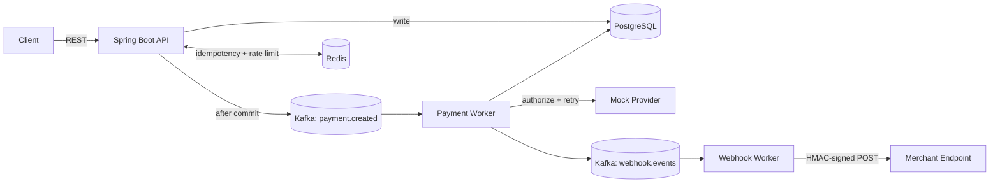
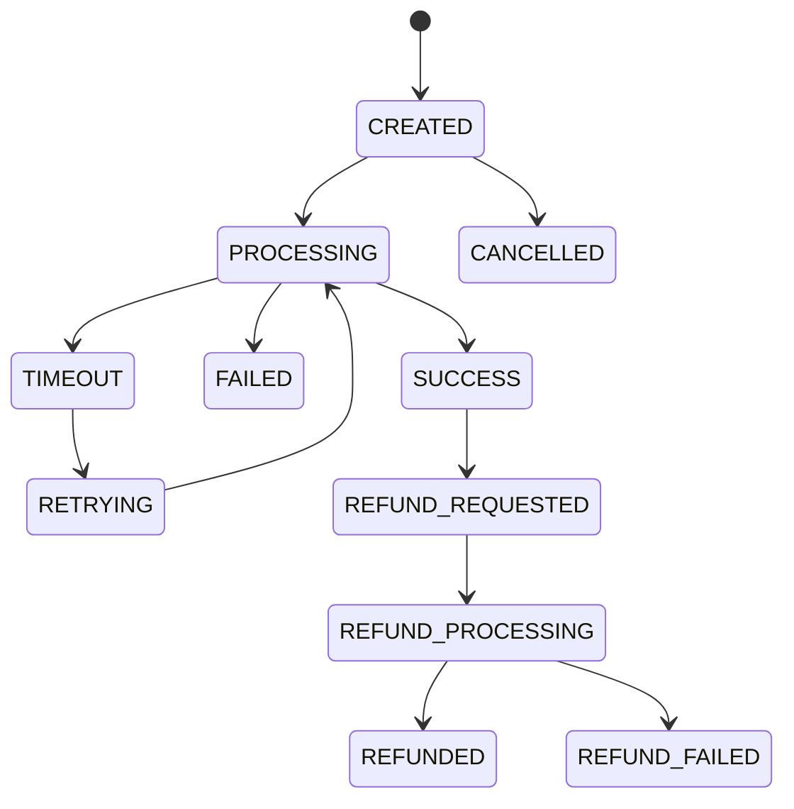

# PayFlow — Fault-Tolerant Payment Processing Engine

A payment infrastructure platform built around **idempotent transaction processing**, **asynchronous event-driven architecture**, **provider failure recovery**, **webhook delivery**, and **payment reconciliation**.

> Portfolio project. Payment providers are simulated (deterministic mocks), but the architecture around them (Kafka, Redis, PostgreSQL, retries, webhooks, reconciliation) is real.

---

## Features

- **Payments API**: create, retrieve, and list payments with pagination and status filtering
- **Idempotency**: duplicate requests with the same `Idempotency-Key` return the original payment
- **Payment state machine**: explicit allowed transitions; illegal transitions are rejected (HTTP 409)
- **Async processing**: Kafka-based worker moves payments through the provider flow
- **Retry engine**: exponential backoff (1s, 2s, 4s, ...) for transient failures only
- **Refunds**: full and partial refunds with over-refund protection
- **Webhooks**: HMAC-SHA256 signed delivery, retries with backoff, duplicate-event protection
- **Reconciliation**: detects `MATCHED`, `AMOUNT_MISMATCH`, `STATUS_MISMATCH`, `MISSING_PROVIDER`, `MISSING_INTERNAL`, `DUPLICATE`
- **Audit logs**: every state-changing action recorded with a correlation ID
- **Auth**: JWT login, role-based access (`ADMIN`, `DEVELOPER`, `VIEWER`), hashed API keys
- **Rate limiting**: Redis-backed per-merchant limits (HTTP 429 + `Retry-After`)
- **Failure simulation**: force provider timeout, failure, slow response, or transient error per payment
- **Observability**: Micrometer metrics, Actuator health, correlation IDs in logs
- **Dashboard**: React UI for payments, refunds, webhooks, reconciliation, audit logs, developer portal

---

## Architecture



**Key design choices**

| Decision | Why |
|---|---|
| Publish to Kafka *after* DB commit | A rolled-back transaction can never leak a Kafka message |
| Two-layer idempotency (Redis `SETNX` + Postgres unique constraint) | Redis for speed, Postgres for durability if Redis fails |
| Dedicated `PaymentStateMachine` component | One source of truth for transitions; testable in isolation |
| Deterministic mock providers and settlement data | Every failure/mismatch scenario is reproducible in tests |
| Provider calls run in a Kafka consumer, not the request thread | API latency doesn't depend on third-party latency |

---

## Tech Stack

**Backend:** Java 21, Spring Boot 3, Spring Security (JWT), Spring Data JPA, PostgreSQL, Redis, Apache Kafka, Flyway, Micrometer, OpenAPI/Swagger
**Testing:** JUnit 5, Mockito, Testcontainers
**Frontend:** React, TypeScript, Vite, Tailwind CSS, React Router
**DevOps:** Docker, Docker Compose, GitHub Actions

---

## Project Structure

```
payflow/
├── backend/           Spring Boot API, Kafka workers, tests
│   └── src/main/java/com/payflow/
│       ├── auth/  merchant/  payment/  refund/  webhook/
│       ├── reconciliation/  audit/  provider/  idempotency/
│       ├── ratelimit/  analytics/  common/  config/
├── frontend/          React + TypeScript dashboard
├── infrastructure/    Deployment configs
├── docs/              Design documentation
├── scripts/           Seed data + helpers
├── .github/workflows/ CI/CD
└── docker-compose.yml
```

---

## Getting Started

### Prerequisites
- Java 21
- Maven 3.9+
- Node.js 20+
- Docker Desktop (running)

### Option 1: Run everything with Docker Compose

```bash
git clone https://github.com/<your-username>/payflow.git
cd payflow
cp .env.example .env        # set JWT_SECRET and WEBHOOK_SECRET
docker compose up --build
```

### Option 2: Local development (hot reload)

```bash
# 1. Start infrastructure only
docker compose up -d postgres redis kafka

# 2. Run the backend
cd backend
mvn spring-boot:run

# 3. Run the frontend (new terminal)
cd frontend
npm install
npm run dev
```

### Load demo data

```bash
./scripts/seed.sh
```

| Service | URL |
|---|---|
| Frontend | http://localhost:5173 |
| Backend API | http://localhost:8080 |
| Swagger UI | http://localhost:8080/swagger-ui.html |
| Health | http://localhost:8080/actuator/health |

**Demo logins** (password `password123`): `admin@payflow.dev`, `dev@payflow.dev`, `viewer@payflow.dev`

---

## API Example

```bash
# Login
curl -X POST http://localhost:8080/api/v1/auth/login \
  -H "Content-Type: application/json" \
  -d '{"email":"admin@payflow.dev","password":"password123"}'

# Create a payment
curl -X POST http://localhost:8080/api/v1/payments \
  -H "Content-Type: application/json" \
  -H "Authorization: Bearer <TOKEN>" \
  -H "Idempotency-Key: $(uuidgen)" \
  -d '{
    "amount": 1499,
    "currency": "INR",
    "paymentMethod": "UPI",
    "merchantId": "00000000-0000-0000-0000-000000000001",
    "description": "Test payment"
  }'
```

Sending the same request again with the **same** `Idempotency-Key` returns the original payment instead of creating a new one.

### Main endpoints

| Method | Endpoint | Description |
|---|---|---|
| POST | `/api/v1/auth/login` | Get a JWT |
| POST | `/api/v1/payments` | Create a payment |
| GET | `/api/v1/payments` | List payments |
| GET | `/api/v1/payments/{id}` | Get a payment |
| POST | `/api/v1/payments/{id}/refund` | Refund (full or partial) |
| POST | `/api/v1/reconciliation/run` | Run reconciliation |
| GET | `/api/v1/audit-logs` | View audit events |
| GET | `/api/v1/analytics/dashboard` | Dashboard stats |
| POST | `/api/v1/merchants/{id}/api-keys` | Create an API key |

---

## Payment State Machine



---

## Testing

```bash
cd backend
mvn test                              # all tests
mvn test -Dtest='!*IntegrationTest'   # unit tests only
mvn test -Dtest='*IntegrationTest'    # Testcontainers tests (requires Docker)
```

Covered: state machine transitions, idempotency (fast path, DB fallback, race resolution), refund rules, retry decisions, provider scenarios, rate limiting, HMAC signing, reconciliation categories, and a Postgres integration test.

---

## Documentation

Detailed design docs live in [`/docs`](docs/): architecture, state machine, idempotency, retry strategy, Kafka design, Redis design, reconciliation, webhook system, database design, scalability, reliability, and interview Q&A.

---

## Known Limitations

- Payment providers are simulated, with no real money movement
- Kafka runs as a single broker locally; production needs a managed multi-broker cluster
- The retry engine blocks the consumer thread during backoff (async delayed retry is a documented next step)
- Logout is client-side only (no server-side JWT revocation)
- No performance benchmarks yet, so no throughput claims are made

## Future Improvements

- Async delayed retries via a delay topic
- Redis cache-aside for payment status reads
- Server-side JWT revocation list
- Automated dependency vulnerability scanning in CI

---

## License

MIT